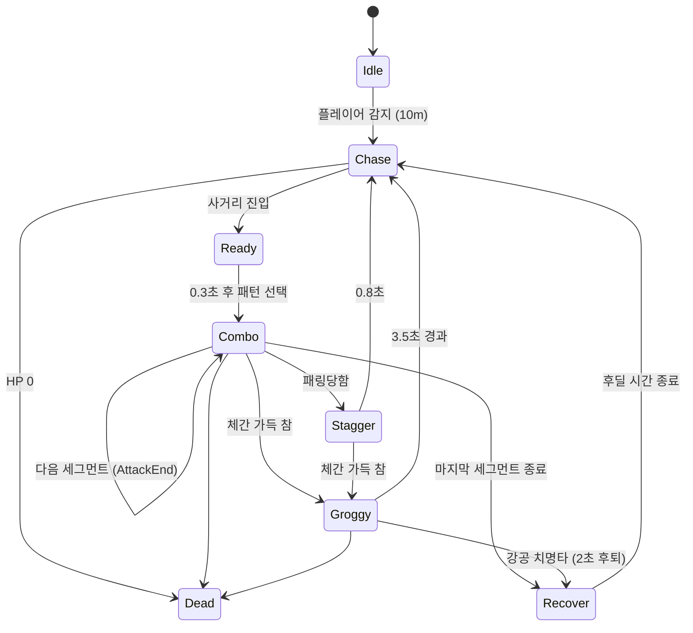
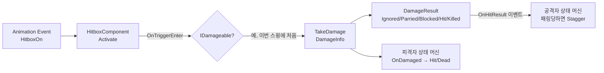

# The Last Warden

멸망한 신성왕국의 성문 앞, 홀로 남아 문을 지키는 기사와 싸우는 3인칭 단일 보스전 액션 게임

> 작성일: 2026/10/27 · 버전 0.1.2

## 개요

- **장르**: 3인칭 소울라이크 보스전 (세키로풍 패링·체간 시스템)
- **플랫폼**: Windows (PC)
- **엔진**: Unity 6.3 LTS (6000.3.23f1), URP 17.3
- **패키지**: Cinemachine 3.1.7, Input System 1.20.0
- **개발**: 1인 개발

### 스토리

오래전 멸망한 신성왕국의 유적. 주변은 모두 폐허가 되었지만 거대한 흰색 고딕 성문만은 온전히 서 있다.
길을 지나던 방랑기사는 그 성문 앞에서, 지금도 서약을 지키고 있는 기사 **성문의 서약기사 알데리크**와 마주친다.

## 조작법

| 입력 | 동작 |
|---|---|
| W A S D | 이동 |
| 마우스 | 카메라 회전 |
| 좌클릭 (탭) | 약공격 — 최대 3연타 |
| 좌클릭 (꾹 누르기) | 강공격 — 그로기 상태의 보스에게 치명타 |
| 우클릭 (탭) | 패링 |
| 우클릭 (꾹 누르기) | 가드 |
| Left Shift | 회피 (구르기, 앞 0.3초 무적) |
| Tab | 락온 켜기/끄기 |
| Esc | 일시정지 메뉴 (감도 조절, 타이틀로, 종료) |
| R | 결과 화면에서 재시작 |

## 주요 기능

- **플레이어 전투**: 약공 3콤보, 홀드 판정 강공, 회피 무적, 스태미나 소모·회복
- **패링 / 가드**: 정면 160° 안의 공격만 막음. 패링 창 안에서 막으면 보스 경직 + 체간 누적
- **체간 → 그로기 → 치명타**: 피격·패링으로 보스 체간이 가득 차면 무릎을 꿇고, 이때 강공격이 치명타로 들어감
- **보스 AI**: 감지 → 추적 → 공격 준비 → 콤보 패턴 → 후딜(간 보기) 순환, 패턴별 쿨다운으로 같은 패턴 연속 방지
- **공격 예고**: 보스가 공격하기 직전 눈에서 붉은 빛이 나서 패링 타이밍을 알려 줌
- **락온 / 소프트 락온**: 락온 중엔 대상을 화면 중앙에 고정. 락온이 아니어도 가까운 적을 향해 공격 방향 보정
- **애니메이션 기반 판정**: 히트박스 On/Off와 콤보 연결 시점을 Animation Event로 지정, 공격 이동은 루트 모션
- **UI**: HP·스태미나 바, 보스 HP·체간 바(세키로식 가운데→양끝), 타이틀, 조작법 화면, 일시정지 메뉴, 승리/패배 결과 화면

## 핵심 시스템 설명

### 1. 상태 머신 (State Pattern)

플레이어와 보스 모두 같은 구조의 상태 머신을 사용합니다.

- `XxxState` (abstract): `Enter` / `Tick` / `Exit` / `OnAnimationEvent`
- `XxxStateMachine`: 현재 상태 하나를 들고 `Update`에서 `Tick`, 상태 전환은 `ChangeState`(이전 상태 `Exit` → 새 상태 `Enter`)
- 상태는 전환할 때마다 `new`로 새로 만들고, 정리(이벤트 구독 해제, 히트박스 끄기)는 항상 `Exit`에서 처리
- 상태 사이에 계속 기억해야 하는 값(패턴 쿨다운, 그로기 여부 등)은 머신에 둠

**플레이어 상태**

| 상태 | 역할 |
|---|---|
| `Idle` / `Move` | 공통 부모 `PlayerGroundedState`에서 공격·회피·가드 입력을 받음 |
| `LightAttack` | 약공 3콤보. 같은 상태 객체가 콤보 번호만 바꿔 이어감. 0.25초 동안 계속 누르고 있으면 `HeavyAttack`으로 전환 |
| `HeavyAttack` | 강공 (공격력 ×3, 체간 피해 큼) |
| `Dodge` | 0.6초 이동, 앞 0.3초 무적 |
| `Guard` / `Parry` | 우클릭 시작 후 0.5초가 패링 창, 이후 가드 |
| `Hit` / `Dead` | 피격 경직(연속 피격 시 연장), 사망 |

**보스 상태 흐름**



### 2. 전투 판정 파이프라인



- **`HitboxComponent`**: 트리거 콜라이더 + Kinematic Rigidbody. `Activate`할 때마다 맞은 대상 목록(`HashSet<IDamageable>`)을 비워 **한 스윙에 한 번만** 맞게 함. 같은 root(자기 몸)는 무시
- **`IDamageable`**: `TakeDamage(in DamageInfo) → DamageResult`. 플레이어(`PlayerCombatTarget`)와 보스(`BossCombatTarget`)가 각각 구현
- **`PlayerCombatTarget` 판정 순서**: 사망 → 무적(회피) → 패링(정면 + 패링 가능한 공격) → 가드(정면, 스태미나 20 소모, 피해 20%) → 일반 피격
  - 확인을 HP 감소보다 먼저 해야 무적·패링이 의미가 있음
- **`DamageResult`**를 공격자에게도 알려 주기 때문에(`OnHitResult` 이벤트), 보스는 자기 칼이 패링당했을 때만 경직에 빠짐

### 3. 애니메이션 이벤트 · 루트 모션

- 히트박스 타이밍은 코드의 타이머가 아니라 **클립에 찍은 Animation Event**(`GlowOn`, `SwordHitboxOn/Off`, `FootHitboxOn/Off`, `AttackEnd`)로 결정
- 이벤트는 `XxxAnimationEvents`(Animator와 같은 오브젝트) → 상태 머신 → **현재 상태**로 전달. 상태가 바뀐 뒤 늦게 도착한 이벤트는 새 상태가 무시하므로 안전
- 공격 이동은 루트 모션. `OnAnimatorMove`에서 `deltaPosition`만 머신에 넘기고, 실제 이동은 상태가 `CharacterController`로 한 프레임에 한 번만 수행
  - Animator(자식 `Model`)와 CharacterController(부모)가 다른 오브젝트라서, 루트 모션을 직접 적용하면 몸과 캡슐이 어긋나기 때문

### 4. 보스 패턴 (ScriptableObject)

`BossPattern` 에셋 하나가 콤보 하나입니다.

| 필드 | 설명 |
|---|---|
| `Segments[]` | 콤보를 이루는 동작들 (Animator 상태 이름, 시작 시점, 대미지, 선딜 중 회전 속도) |
| `Cooldown` | 한 번 쓴 뒤 다시 고를 수 있을 때까지의 시간 |
| `RecoveryMin/Max` | 콤보가 끝난 뒤 후딜(간 보기) 시간 범위 — 플레이어의 반격 기회 |

`BossStateMachine.PickPattern()`은 쿨다운이 끝난 패턴 중에서 무작위로 고릅니다.
새 패턴은 **코드 수정 없이** 클립에 이벤트를 찍고 `BossPattern` 에셋만 추가하면 됩니다.

### 5. 체간 (Poise)

- `PoiseComponent`: 보스 체간 0 → 100. 약공(대미지의 50%), 강공(100%), 패링(30)으로 누적
- 3초간 맞지 않으면 초당 10씩 회복 → 몰아붙여야 그로기를 낼 수 있음
- 가득 차면 `OnBroken` → `BossGroggyState`(3.5초). 이때 강공은 치명타(250)

### 6. UI

- `IGauge`(`Ratio`, `OnChanged`)를 `HealthComponent` · `StaminaComponent` · `PoiseComponent`가 구현 → **`GaugeBarUI` 하나**로 모든 바를 표시
- 보스 바는 락온 범위 안에 들어오면 페이드 인 (`BossBarVisibility`)

## 프로젝트 구조

```
Assets/_Project/
├─ Scenes/           Title(타이틀), Arena(전투)
├─ Scripts/
│  ├─ Player/        입력, 이동, 락온, 무기 그립, 애니메이션 이벤트
│  │  └─ StateMachine/   플레이어 상태들
│  ├─ Boss/          BossCombatTarget, BossPattern(SO), 애니메이션 이벤트
│  │  └─ StateMachine/   보스 상태들
│  ├─ Combat/        DamageInfo, IDamageable, HitboxComponent, Health/Stamina/Poise
│  ├─ Core/          GameFlowController(승패·재시작), CursorLock
│  └─ UI/            GaugeBarUI, TitleMenu, PauseMenu, ControlsScreen
├─ ScriptableObjects/BossPatterns/   보스 콤보 패턴 에셋
├─ Animations/       Player/, Boss/ (Animator Controller + 클립)
├─ Models/           캐릭터·무기·성문 모델
├─ Prefabs/  Materials/  Fonts/  Input/
└─ Editor/           에디터 자동화 도구 (클립 임포트 설정, Animator·패턴 이벤트 설정, 숲·조명·성문 배치, 타이틀 씬 구성)
```

## 실행 방법

**빌드 실행**
1. 빌드 폴더의 `The Last Warden.exe` 실행

**에디터에서 실행**
1. Unity Hub에서 **Unity 6000.3.x**로 프로젝트 열기 (같은 6000.3 패치끼리는 호환)
2. `Assets/_Project/Scenes/Title.unity` 열기 → Play
3. 빌드 순서: `Title`(0) → `Arena`(1)

## 사용 에셋

| 종류 | 에셋 |
|---|---|
| 플레이어 모델 | Medieval Knight Sculpture (Game Ready) |
| 플레이어 무기 | The Majestic Sword of Golden Blood (Game Ready) |
| 보스 모델 | Knight with Sword (Unity Asset Store) |
| 플레이어 애니메이션 | Mixamo Pro Sword and Shield Pack, Free Sword Animations (EEJANAI Team) |
| 보스 애니메이션 | RPG Animations Pack FREE (DoubleL), Great Sword Pack, Mixamo |
| 배경 | Realistic Tree, 성문(HolyGate) — Blender로 직접 제작 |
| 폰트 | Cinzel, Nanum Myeongjo, Yuji Boku (SIL Open Font License) |

각 에셋의 라이선스는 해당 폴더의 라이선스 문서를 따릅니다.

## 참고사항

- **회복(Q)**: 입력만 연결되어 있고 기능은 아직 없음
- **예정**: 인트로 문구, 강화 NPC(보스에게 준 피해량만큼 재화 획득, 패배해도 유지), 그로기 후 일어나는 모션, 히트스톱·카메라 셰이크·사운드
